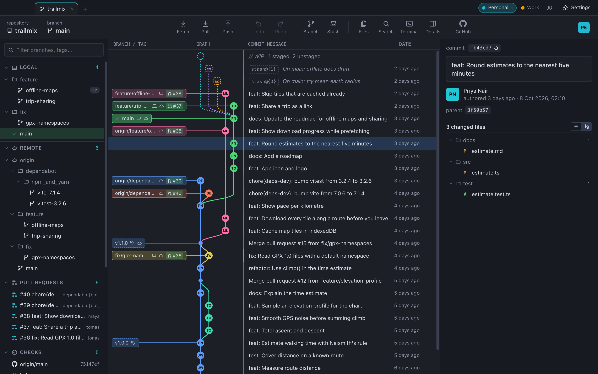
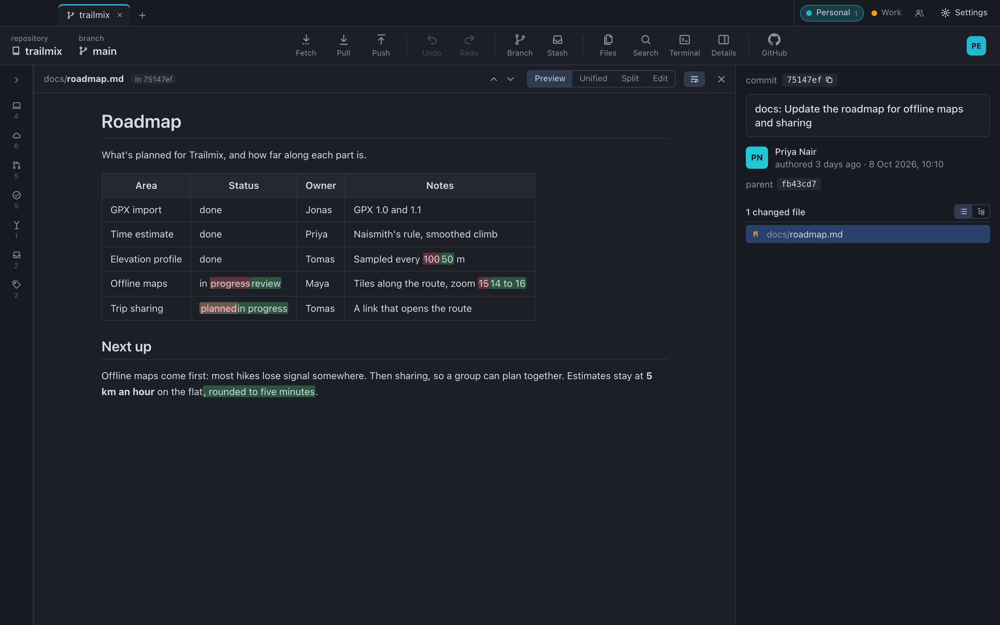
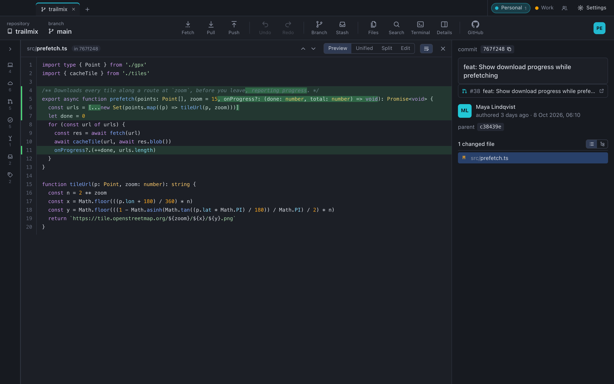
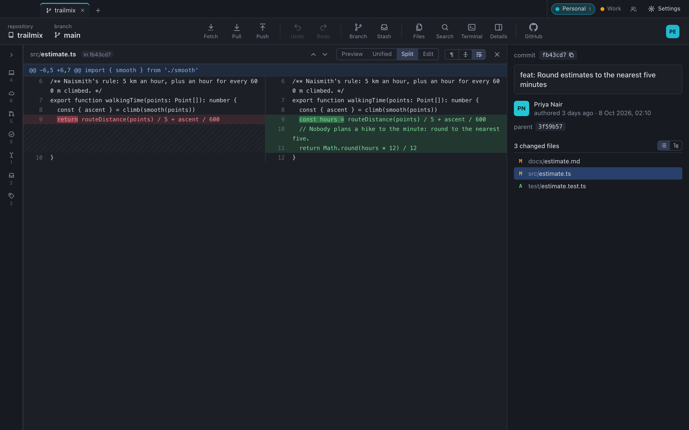
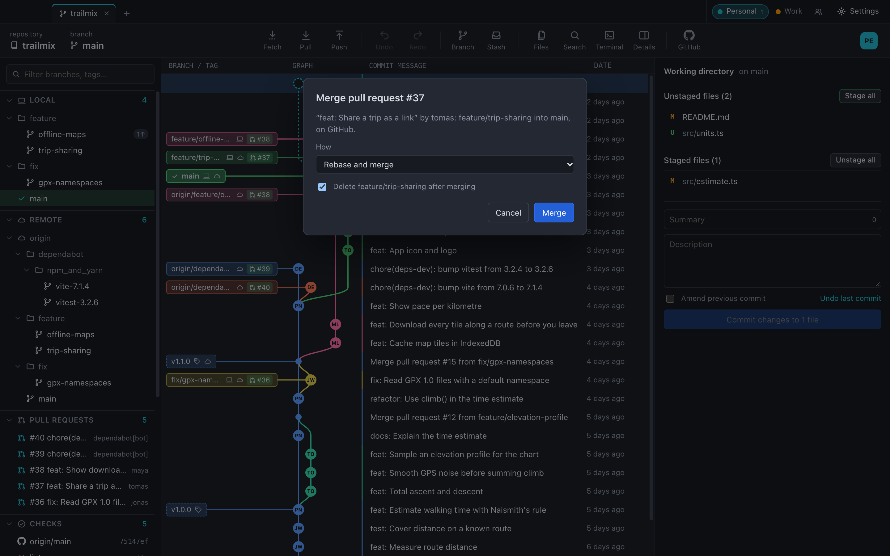
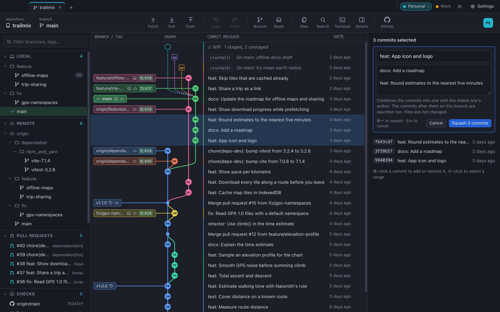
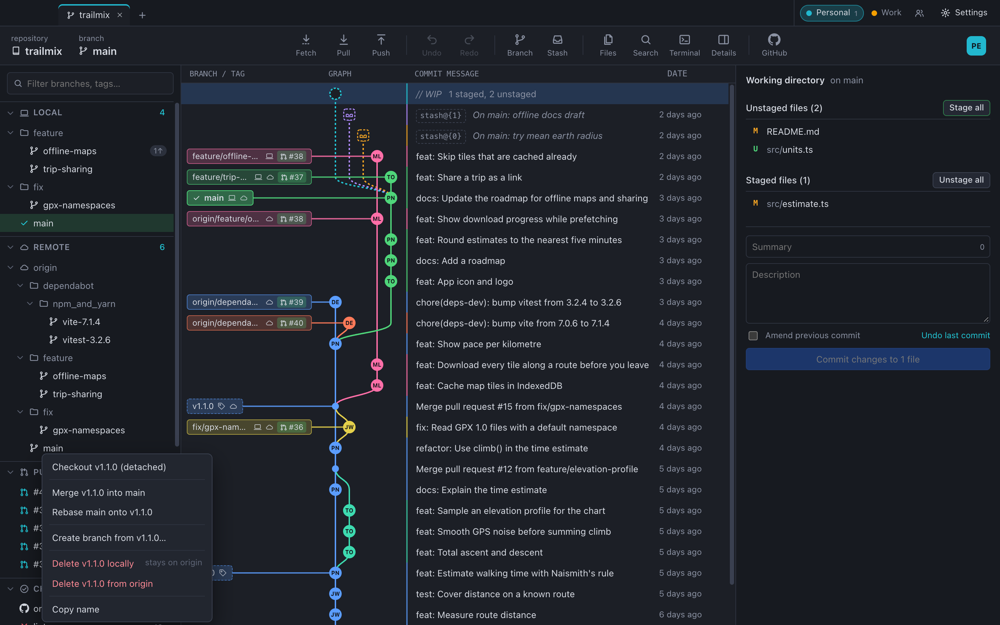
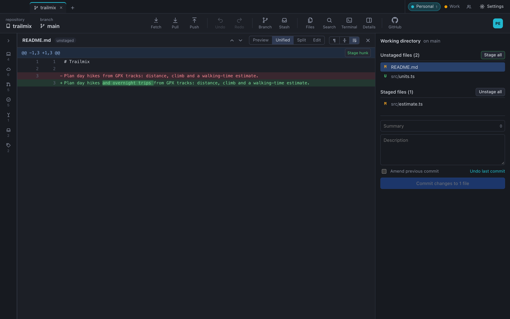
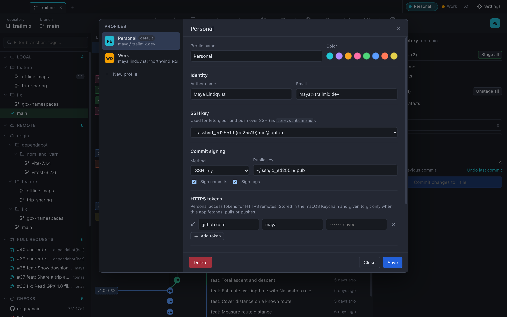
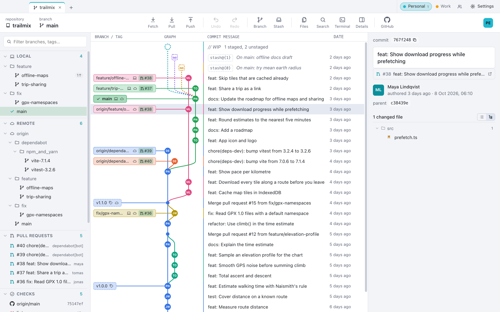

# Git Client

> [!NOTE]
> If you've stumbled on this repository by accident: this is a personal hobby project of mine. I got
> tired with Git clients that are absurdly large, require subscriptions, and are so full of spyware
> and adware that you can't tell what data goes where. This client is super lightweight: a thin
> interface built on Tauri, mainly to make managing branches easier. I've shared it here for my
> friends, but if you happen to like it, feel free to use it. No guarantees or support of any kind,
> though: as I said, this is a hobby project. Note that this package doesn't include Git itself; you
> need to have it installed.

A fast desktop Git client for macOS, Windows and Linux. It runs your own `git`, so your config,
hooks, credential helpers, signing and worktrees behave exactly as they do in the terminal.



## Install

### Homebrew (macOS)

```sh
brew install --cask artti-jaakkola/tap/git-client
```

`brew upgrade` then keeps it up to date.

### By hand

Get the latest version from
[Releases](https://github.com/artti-jaakkola/git-client-releases/releases/latest), where each
version lists what's new.

**macOS:** open the `.dmg` and drag Git Client to Applications. The app is not signed with an Apple
Developer ID, so macOS blocks the first launch: open System Settings → Privacy & Security and choose
**Open Anyway**.

**Windows:** run the `-setup.exe` (or the `.msi`). The installer is not code-signed, so SmartScreen
may warn: choose **More info → Run anyway**.

**Linux (x86-64):** install the `.deb` (Debian, Ubuntu) or `.rpm` (Fedora, openSUSE), or make the
`.AppImage` executable and run it. Saved tokens are kept in the Secret Service (GNOME Keyring or
KWallet).

Git must be installed; the app uses your own git.

## Features

**History**
- Commit graph of all branches, remote branches, tags and stashes, with colored lanes
- Switch branches and tags with a click; drag one branch onto another to merge or rebase
- Compare two commits like a pull request: the commits and files one would bring into the other,
  and whether merging would fast-forward, merge cleanly or conflict
- Search commits by message, author, id or changed file names, and search file contents
- Browse the files of any commit, with each file's history
- A commit's changed files as a list or as a tree of their folders

**Changes**
- Unified and split diffs that highlight the exact change within an edited line
- Preview a change as the file reads: rendered Markdown and text with the changed words marked in
  place, and code with its changed lines marked, keeping its syntax colors
- Where the changes are, marked in the scrollbar; ⌥↑ and ⌥↓ jump between them
- Find text in file previews (⌘F)
- Stage and unstage whole files, hunks or single lines
- Hide whitespace-only changes, or show the whole file around them
- Edit working-tree files right in the app
- Commit, amend, and reword earlier commits on the current branch
- Squash consecutive commits: select them with ⌘-click or ⇧-click
- Apply patch files, as working-tree changes or as the commits of a `git format-patch` file

**Branches and merging**
- Create, rename and delete branches, here or on their remote; merge, rebase, cherry-pick, revert
  and reset
- Undo and redo (⌘Z, ⇧⌘Z) commits, checkouts, merges, rebases, resets, squashes and more
- See which remotes have each tag; push a tag, or delete it locally or from a remote
- Resolve merge conflicts in a merge editor, one conflict at a time
- Stash, apply, pop, drop and rename stashes
- Create and open worktrees, each in its own tab

**GitHub, GitLab, Bitbucket, Gitea, Forgejo and Azure DevOps**
- Clone any of your repositories from a searchable list, or by URL
- Open pull and merge requests shown next to their branches
- Approve and merge pull requests in the app: rebase, squash or a merge commit, and delete the
  branch after
- CI checks of your branch in the sidebar
- Pushing a repository without a remote offers to create it on your host

**Profiles**
- Keep work and personal identities apart: author, SSH key, commit signing and HTTPS tokens
- Repositories pick their profile by folder or remote URL; each profile has its own tabs
- Tokens are stored in the macOS Keychain, Windows Credential Manager or the Linux Secret Service

**And**
- Fetches in the background without ever prompting for a password or a security key touch
- A terminal in the repository, one keystroke away (⌃\`)
- Dark and light themes that follow the system

## Screenshots

A commit's Markdown change in Preview: the changed words marked in place, here in a table:



Code in Preview keeps its syntax colors, with the changed lines and characters marked:



Split diff of a commit, with the exact change within each line highlighted:



Merging a pull request from the app:



Squashing three commits into one:



A tag that is both here and on origin, which can be deleted from either:



Staging changes and writing a commit:



Profiles for work and personal repositories:



Light theme:


